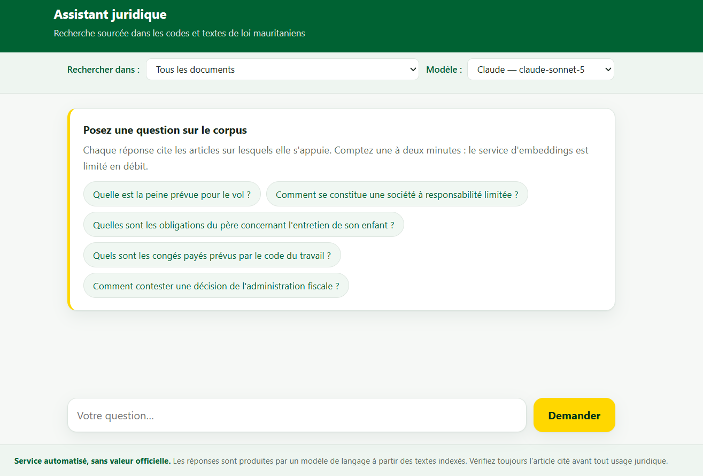
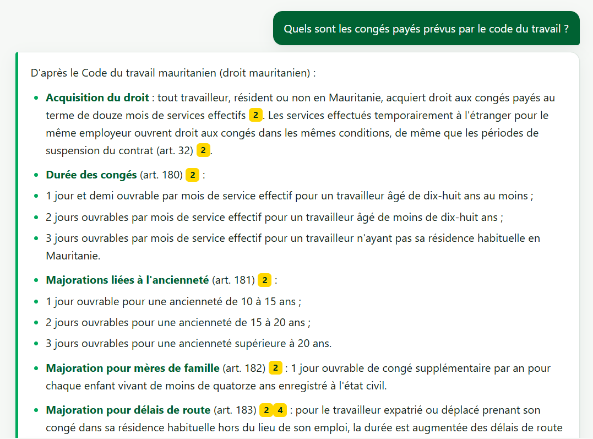
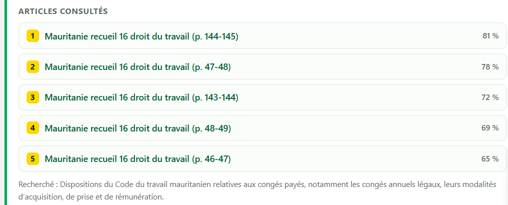

# legalrag

**Retrieval-augmented question answering over Mauritanian law, with answers
that cite the exact passages they rely on.**

The corpus covers 43 French-language legal codes and collections, about
12,000 chunks. Every claim in an answer carries the number of its source
passage, and citations are checked after generation.







## How it works

```
Indexing (offline)
  PDF → pages .txt → header/footer removal → page stitching + overlapping chunks
      → contextual embeddings (voyage-context-4) → Parquet index → Qdrant

Answering (online)
  question → LLM query rewriting → vector search → split by legal article
           → reranking → answer by Groq (gpt-oss-120b) or Claude, with citation checks
```

## Design choices

- **Embedding model chosen on structural grounds.** `voyage-context-4`,
  `voyage-law-2`, `text-embedding-3-large` and `mistral-embed` were compared.
  Contextual embeddings were picked because articles are split across scanned
  pages. The index refuses to mix vectors from two models.
- **Statistical boilerplate removal.** Repeated scanned headers and footers
  are detected per document and removed before chunking (7.8 % of
  characters, 378 → 348 chunks on the pilot corpus).
- **Retrieval tuned to legal text.** Chunks are split on article headers
  before reranking, so the relevant article is not drowned among ~6 others.
- **Query rewriting, measured honestly.** Rewriting colloquial questions into
  the corpus vocabulary renews a third to half of the top-25 candidates and
  widens document coverage. A gain in answer quality is *not* claimed: it
  would need a reference Q&A set, which does not exist yet.
- **Guardrails against plausible-but-wrong answers.** Numbered passages,
  mandatory citations, post-hoc check of cited indices, and an explicit
  "not in the documents" fallback.
- **Production hygiene.** Resumable, idempotent indexing with atomic Parquet
  writes; FastAPI web UI; slim non-root Docker image (42 packages instead
  of 90).

## Quick start

Dependencies are managed with [uv](https://docs.astral.sh/uv/).

```bash
uv sync --all-groups
cp .env.example .env   # then fill in the API keys
```

| Variable | Used for |
|---|---|
| `VOYAGE_API_KEY` | Embeddings and reranking |
| `GROQ_API_KEY`, `ANTHROPIC_API_KEY` | Answer generation (either or both) |
| `QDRANT_URL`, `QDRANT_API_KEY` | Vector store (embedded on disk by default) |
| `GOOGLE_APPLICATION_CREDENTIALS`, `DRIVE_FOLDER_ID` | Reading the corpus from Google Drive |

```bash
uv run legalrag index --prune --compact   # build the embedding index
uv run legalrag qdrant                    # load it into Qdrant
uv run legalrag ask "votre question"      # answer in the terminal
uv run legalrag serve                     # web UI on http://127.0.0.1:8000
docker compose up --build                 # or run the web UI in Docker
```

## Tests

```bash
uv run pytest
```

443 tests, none of which call the network. They cover file-name parsing,
chunking across pages, batching, chunk/vector pairing and crash recovery.

## Limitations

- No reference Q&A set yet. Without one, the embedding model choice, the
  benefit of query rewriting and the Groq vs Claude comparison remain
  unmeasured.
- Each answer takes one to two minutes on a free Voyage account, which is
  capped at 3 requests per minute.

## Documentation

The full design notes, setup guides and trade-offs are in French:

- [docs/conception.md](docs/conception.md): design and operations (model
  comparison, chunking, indexing and recovery, retrieval, generation, web
  UI, Docker)
- [Voyage](docs/configuration-voyage.md),
  [Google Drive](docs/configuration-google-drive.md),
  [Qdrant](docs/configuration-qdrant.md) and
  [Anthropic](docs/configuration-anthropic.md) setup guides
